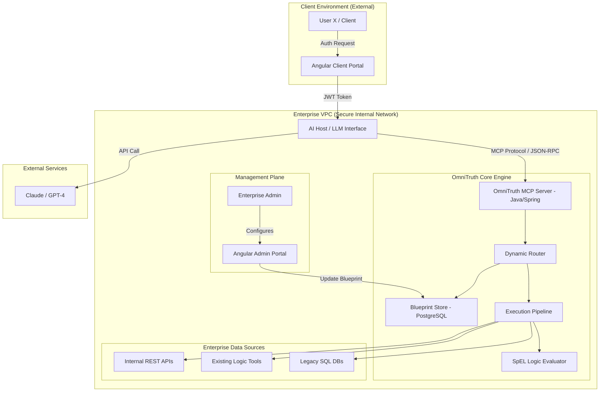

# OmniTruth: Full Architecture & Technical Blueprint

## 1. High-Level Architecture Diagram (Conceptual)

---

## 2. Identity & Access Management (IAM) Detail

To ensure absolute security in an enterprise environment, OmniTruth implements a layered security model combining **OAuth2**, **JWT**, and **RBAC**.

### 2.1 Authentication Flow (OAuth2 / OIDC)
1.  **User Login:** The user logs into the Angular Portal via the company's Identity Provider (IdP) like Azure AD, Okta, or Keycloak using **OAuth2/OpenID Connect**.
2.  **Token Issuance:** The IdP issues an **Access Token (JWT)** containing the user's identity and their assigned roles.
3.  **Token Propagation:** Every single request from the Portal to the AI Host, and from the AI Host to the MCP Server, carries this JWT in the Authorization header.

### 2.2 Authorization & RBAC (Role-Based Access Control)
Access is governed by a strict RBAC matrix stored in the PostgreSQL database.

| Role | Permissions | Access Level |
| :--- | :--- | :--- |
| **System Admin** | `CREATE_TOOL`, `EDIT_BLUEPRINT`, `VIEW_HEALTH` | Full access to Admin Portal & all MCP Tools. |
| **Company Employee** | `EXECUTE_TOOL`, `VIEW_DASHBOARD` | Access to internal-facing tools only. |
| **Client (User X)** | `EXECUTE_TOOL_SCOPED` | Access ONLY to tools mapped to their own `clientId`. |

### 2.3 Scoped Tool Execution (The Security Guard)
The MCP server does not trust the AI's request blindly. It implements a **Guardrail Layer**:
*   **Request:** AI calls `get_shipment_status(id="S-992")` with User X's JWT.
*   **Validation:** The MCP server extracts `userId` from the JWT and queries the database: *"Does User X have permission to view Shipment S-992?"*
*   **Execution:** If **YES**, the API call is made. If **NO**, the MCP returns a `SecurityException`, and the AI tells the user: *"You do not have permission to access this specific record."*

---

## 3. Detailed Technical Specifications

### 3.1 The "Zero-Hard-Coding" Engine
**Technology Stack:** Java 21, Spring Boot 3.x, Spring AI.

*   **The Dynamic Router:** A component that reads the `TenantID` from the JWT and loads the corresponding JSON Blueprint.
*   **The Pipeline Executor:**
    1.  **Fetch:** `GenericRestConnector` or `SqlConnector` retrieves raw data.
    2.  **Normalize:** A `DataTransformer` cleans JSON into a flattened Map.
    3.  **Verify:** `SpelExpressionParser` evaluates rules (e.g. `#{payload.status == 'DELIVERED'}`).

### 3.2 The Admin & Client Portals
**Technology Stack:** Angular 17+, TypeScript, Tailwind CSS.

*   **Admin Portal:** Features a **Visual Workflow Builder** (React Flow style) and a **Health Dashboard** (Heartbeat monitor).
*   **Client Portal:** A conversational interface with **Truth Cards** that display verified data points returned by the MCP.

### 3.3 Observability & Reliability
*   **Heartbeat System:** A Spring `@Scheduled` task that pings all endpoints every 60s.
*   **Circuit Breaker:** `Resilience4j` prevents the AI from hanging if an internal API is down.
*   **Audit Logging:** Every tool call is logged to the client's internal ELK/Splunk stack for compliance.

---

## 4. Summary of Data Flow
`User (JWT)` $\rightarrow$ `Angular Portal` $\rightarrow$ `AI Host` $\rightarrow$ `MCP Server (RBAC Check)` $\rightarrow$ `Dynamic Blueprint` $\rightarrow$ `Enterprise API/DB` $\rightarrow$ `Normalizer` $\rightarrow$ `AI Synthesis` $\rightarrow$ `User Answer`.
